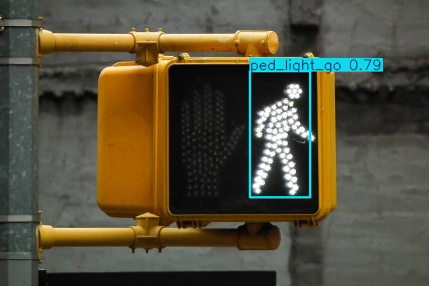
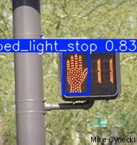
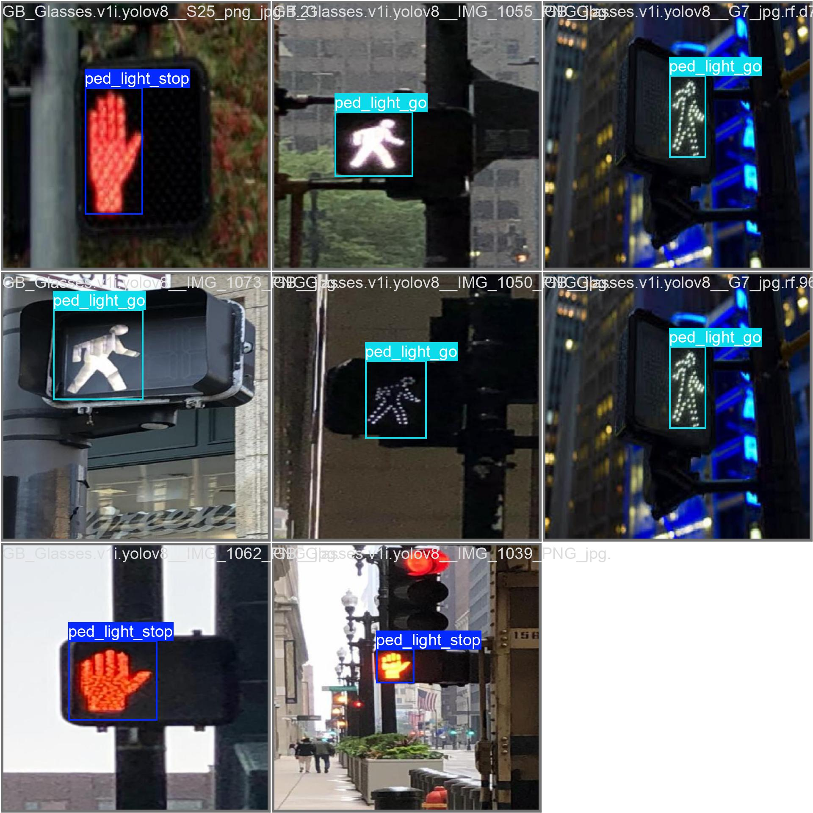

# UGV Autonomous Pedestrian Signal Detection (YOLOv8)
**High-Fidelity Deep Learning Model** designed for real-time interpretation of **American-Style Pedestrian Traffic Signals** within an **Unmanned Ground Vehicle (UGV) autonomy stack.**

---

### Project Objectives

* **Goal:** Develop a **robust** Computer Vision pipeline for UGV autonomous navigation, strictly focused on **Pedestrian Safety Compliance.**
* **Function:** Achieve real-time detection and classification of all critical road signals, addressing the unique challenge of differentiating and interpreting **Pedestrian WALK/DON'T WALK (GO/STOP) signals.**

### Methodology Highlights

* **Architecture:** Utilizes the **YOLOv8** object detection framework.
* **Data Strategy:** The model was trained using **two merged and annotated datasets** to ensure comprehensive coverage of unique **Pedestrian Signal iconography** (e.g., hand/walking figure) and environmental variability.

  
### Dataset Download Links

* https://universe.roboflow.com/gbglasses/gb_glasses
* https://universe.roboflow.com/merlimar-zt8am/auralvision

### Training Setup

* **Initialization:** trained **from scratch** (model built from `yolov8.yaml`, random weights), then **fine-tuned** from the best checkpoint.
* **Hardware:** multi-GPU data-parallel training on a Linux GPU server (4 GPUs).
* **Schedule:** 100 epochs, image size 1280, batch 8, cosine learning-rate decay (1e-4 to 1e-5), early-stopping patience 20; fine-tuning 20 epochs.
* **Evaluation:** separate train / validation / test splits; curves, confusion matrices and predictions are in `output_runs/` and `fine_tune_output_runs/`.

### Results

| Model | Validation mAP@50 (best epoch) | Validation mAP@50-95 | Test mAP@50 |
|---|---|---|---|
| Trained from scratch | 0.968 | 0.734 | 0.988 |
| After fine-tuning (deployed) | **0.970** | **0.782** | **0.982** |

Test per class (fine-tuned): `ped_light_stop` 0.979, `ped_light_go` 0.985. Precision-recall curves and confusion matrices for each split are in `output_runs/` and `fine_tune_output_runs/`.

Classes: `ped_light_stop` (DON'T WALK) and `ped_light_go` (WALK). This model feeds the crosswalk decision logic of my thesis UGV.

### Inference Results

Below are samples of the model running on unseen validation data:

**1. Pedestrian WALK Signal Detection**

**2. Pedestrian DON'T WALK Signal Detection**

**3. Combination Of Pedestrian WALK/DON'T WALK Signal Detectiong**

